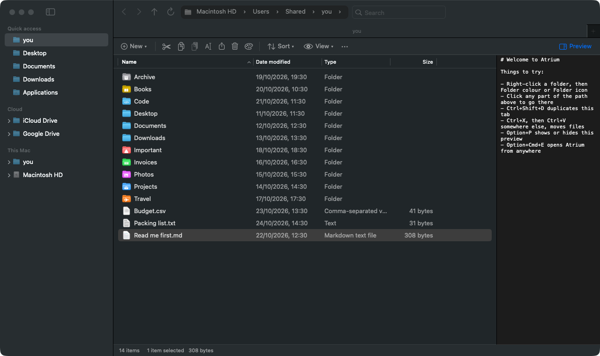

# Atrium

A light file browser for macOS that works like Windows Explorer: a folder tree on the left, an address bar you can type into, a command bar, a Details view with sortable columns and groups, a preview pane, tabs, and the Windows keys you already know. It is native AppKit: no Electron, no web view, no background polling.



## What's in version 0.1

- **Navigation pane**: Quick access (Home, Desktop, Documents, Downloads, iCloud Drive, Applications and your pinned folders), then This Mac with a folder tree and every drive. Right-click to pin, unpin or eject; middle-click opens in a new tab.
- **Address bar**: a breadcrumb you click; click beside it (or press Ctrl+L, Option+D or F4) to type a path. It understands `~/Documents`, `..`, `Documents\Work`, quoted paths, and words like `downloads`.
- **Command bar**: New (folder or text document), Cut, Copy, Paste, Rename, Share, Delete, Sort, View and a "…" menu with Copy as path, Open in Terminal, Pin to Quick access, Compress to ZIP and Properties. The Preview toggle sits on the right.
- **Details view**: Name, Date modified, Type and Size; click a header to sort, drag to resize or reorder; folders always come first. Group by Type or Date modified (Today, Yesterday, Earlier this week…).
- **Cut and paste that moves**: cut items fade until you paste them. Pasting into the same folder makes "Report - Copy.pdf". If a name is taken you choose Keep Both, Replace (the old one goes to the Trash) or Skip.
- **Drag and drop**: Explorer's rules: on the same drive a drag moves, to another drive it copies; hold Option to copy, Command to move. Dropping on the Dock's Trash moves to the Trash.
- **Rename in place** with F2: only the name is selected, not the extension, and changing the extension asks first.
- **Undo** (Ctrl+Z) and **Redo** (Ctrl+Y) for copy, move, rename, new folder and Move to Trash, shared across all windows.
- **Search** box: matches in the current folder show at once, matches in subfolders follow from Spotlight a moment later, with a Folder column so you can see where each one is.
- **Preview pane** (Option+P) drawn by Quick Look, and Space for the Quick Look panel.
- **Properties** (Option+Return or Cmd+I): type, location, size and size on disk, with folder contents counted in the background.
- **Tabs**: Ctrl+T or Cmd+T, and the tab bar's + button.
- **Open With**, **Open in Terminal**, **Open in Finder**, **Copy as path**, **Compress to ZIP**, **Show hidden items** (Shift+Cmd+.).

## Keys

Ctrl and Cmd both work for the usual shortcuts, so Windows habits and Mac habits are both fine.

| Key | Does |
| --- | --- |
| Ctrl/Cmd + C, X, V | Copy, cut, paste (paste after cut moves) |
| Ctrl/Cmd + Z, Ctrl+Y | Undo, redo |
| Ctrl/Cmd + A | Select all |
| Ctrl+Shift+N, Cmd+Shift+N | New folder |
| F2 | Rename (fn+F2 on a MacBook keyboard, unless F-keys are set as standard keys) |
| Return | Open (Ctrl/Cmd+Return opens a folder in a new tab) |
| Delete key (Backspace) | Back |
| Forward delete, Ctrl+D, Cmd+Backspace | Move to Trash |
| Shift+Forward delete, Option+Cmd+Backspace | Delete permanently, after asking |
| Option+Left / Right / Up | Back, forward, up one level (Cmd+[, Cmd+], Cmd+Up also work) |
| Ctrl+L, Option+D, F4, Cmd+L | Type in the address bar |
| Ctrl+F, Ctrl+E, F3, Cmd+F | Search |
| F5, Ctrl+R, Cmd+R | Refresh |
| Option+P | Preview pane |
| Option+Return, Cmd+I | Properties |
| Space | Quick Look |
| Ctrl/Cmd + T, W, N | New tab, close tab, new window |
| Option+Cmd+E (anywhere) | New Atrium window, like Win+E |

## Light in the background

Atrium stays running after its last window closes so that the hotkey and "Show in Finder" open a window at once. While no window is open it is not in the Dock or the app switcher, holds no icons or previews, and watches no folders. It reacts only to the hotkey and to the system asking it to show something.

Closing a window leaves system caches behind (Core Animation, the memory allocator) that macOS keeps, so a used Atrium would sit at around 80 MB. A minute after the last window closes, if no copy is running and nothing is waiting to be pasted after a cut, Atrium restarts itself in place: same process, still in the background, back to its starting size. That one-off timer is the only thing that ever runs while it is idle. Change the delay with `defaults write io.kgswx.atrium IdleRestartSeconds 300`, or set it to 0 to turn this off. The undo history does not survive the restart.

Measured on a MacBook running macOS 26.6 (optimised builds, 27 October 2026):

| State | Memory (footprint) | CPU | Wake-ups |
| --- | --- | --- | --- |
| Running, no window (fresh start) | 10 MB | 0.0% (0.05 s of CPU since launch) | 0 |
| One window, preview pane showing a file | 65 MB | 0.0% at rest | 0 |
| Just after the last window closes, following a full self-test run | 81 MB | 0.0% | 0 |
| A minute later, after the restart in place | 8 MB | 0.0% | 0 |

The app is 2.6 MB (universal: Apple silicon and Intel). An open folder is watched with a single kernel event on that folder, never by polling; a folder of thousands of files costs one icon per file type, not one per file.

## Install

Needs macOS 14 or later and Xcode or the Command Line Tools.

```bash
git clone https://github.com/kgswx/atrium.git
cd atrium
./scripts/install.sh --default
```

This builds Atrium, copies it to `~/Applications` and starts it in the background now and at every login (a LaunchAgent, `io.kgswx.atrium`). With `--default` it also sets Atrium as the file viewer (`NSFileViewer`), so "Show in Finder" in Chrome, VS Code, Xcode and most other apps opens Atrium with the files selected.

Leave out `--default` to install it alongside Finder only. Both settings can be switched from the Atrium menu: **Use Atrium for "Show in Finder"** and **Start Quietly at Login**.

Finder keeps running whatever you choose. It draws the desktop, owns the Trash window and AirDrop, and stays the default app for folders: macOS refuses to give that to any other app (it answers `paramErr`), so a folder opened from another app, or with `open .` in Terminal, still opens in Finder. To open a folder from Terminal in Atrium, use `open -a Atrium .`, or add `alias here='open -a Atrium .'` to `~/.zshrc`.

To remove Atrium and give everything back to Finder:

```bash
./scripts/uninstall.sh
```

### Folder permissions

macOS asks once before any app reads Desktop, Documents, Downloads, iCloud Drive or a removable drive. The build is signed ad hoc, so macOS treats each rebuild as a new app and asks again. To keep permissions across rebuilds, sign with your own certificate: `SIGN_ID="Apple Development: Your Name" ./scripts/install.sh`. For protected folders such as `~/Library/Mail`, allow Atrium under System Settings > Privacy & Security > Full Disk Access.

### Hotkey

The default is Option+Command+E. To change it, or turn it off with an empty string, then restart Atrium:

```bash
defaults write io.kgswx.atrium HotKey "ctrl+opt+e"
```

## Develop

```bash
swift build                # debug build
swift test                 # unit tests for listing, sorting, grouping, naming and paths
./scripts/selftest.sh      # drives a real, invisible window through the keys above in a scratch folder
./scripts/build.sh         # build/Atrium.app
```

The self-test (debug builds only) opens a window on a scratch folder under `build/`, sends the keys through the same key map and menu shortcuts as a real key press, and checks the result on disk: copy and paste naming, cut and paste moving, rename with F2, undo and redo, Move to Trash and back, navigation, the address bar, hidden items, grouping, search and Properties.

| Where | What |
| --- | --- |
| `Sources/AtriumCore` | Reading folders, sorting, grouping, Explorer-style names, address-bar parsing. No AppKit; unit tested. |
| `Sources/Atrium/BrowserWindowController.swift` | One window or tab: navigation, commands, menus, search. |
| `Sources/Atrium/FileListController.swift` | The Details view, rename in place, drag and drop, Quick Look. |
| `Sources/Atrium/SidebarController.swift` | The navigation pane. |
| `Sources/Atrium/FileOperations.swift` | Copy, move, trash, delete, zip, and the shared undo history. |
| `Sources/Atrium/KeyMap.swift` | The Windows keys. |
| `Sources/Atrium/AppDelegate.swift` | Staying resident, the hotkey, "Show in Finder", tabs and windows. |

## Ideas for later

- Large icons and a thumbnail view, and a per-folder memory of view, sort and column widths.
- A copy queue with progress, pause and cancel for big transfers.
- Breadcrumb arrows that list sibling folders, and autocomplete while typing a path.
- Dual pane (side by side) for moving files between two folders.
- Folder sizes in the Size column, computed on request.
- Tags and Finder comments as columns.
- Network locations (SMB, SFTP) in the navigation pane.

## Licence

MIT. See [LICENSE](LICENSE).
